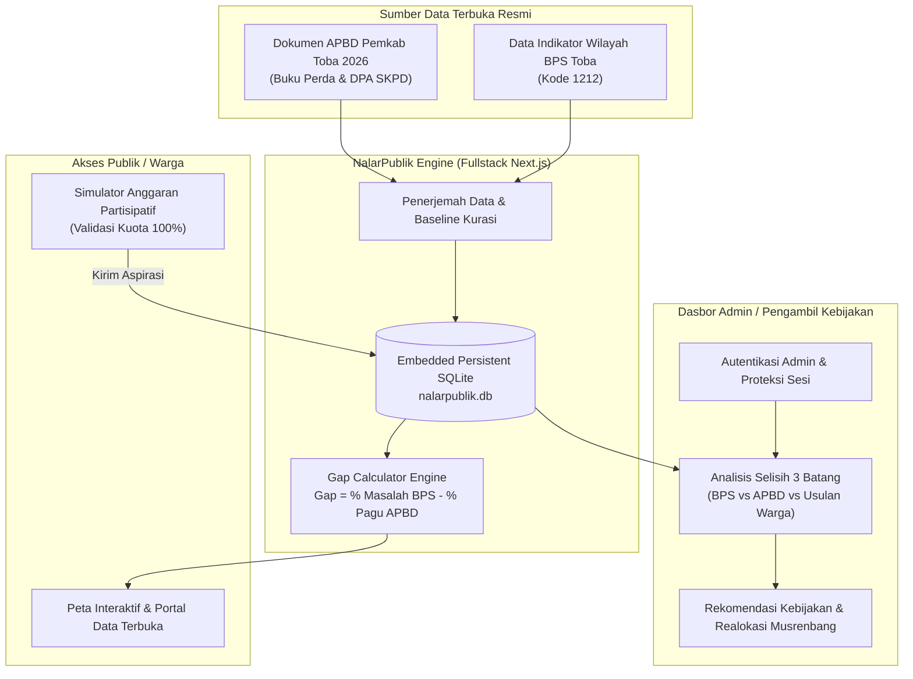

# NalarPublik

**Sistem Pendukung Keputusan Alokasi Anggaran Daerah Berbasis Analisis Gap Data Terbuka**

[](https://nextjs.org/)
[](https://www.typescriptlang.org/)
[](https://tailwindcss.com/)
[](https://www.sqlite.org/)
[](LICENSE)

> *"Dari data publik kaku menuju prioritas pembangunan yang transparan, partisipatif, dan berbasis bukti."*

NalarPublik adalah platform *Civic-Tech* independen untuk kompetisi **Web In Action (WIA) — Multimedia In Action 2026** pada subtema **Data-Driven Decision Support**. Platform ini dirancang untuk menjembatani dokumen anggaran daerah (APBD) yang teknokratis dan data indikator lapangan (BPS) ke dalam visualisasi interaktif, simulator alokasi partisipatif bagi warga, serta dasbor analitis rekomendasi kebijakan bagi pengambil keputusan.

---

## Informasi Karya & Tim

* **Nama Tim:** Kopi Hitam Pekat
* **Judul Karya:** NalarPublik
* **Cabang Lomba:** Web In Action (WIA) 2026
* **Tema Utama:** *Designing Digital Futures*
* **Sub-Tema:** *Data-Driven Decision Support*
* **Wilayah Pilot:** Kabupaten Toba, Sumatera Utara (Kode BPS: `1212`)
* **Kecamatan Percontohan:** Balige, Laguboti, Porsea, dan Habinsaran

---

## Latar Belakang & Problem Statement

1. **Tantangan Transparansi Dokumen:** Dokumen APBD daerah umumnya dirilis dalam format buku tebal atau file PDF ratusan halaman (Perda Penjabaran APBD & DPA SKPD) tanpa public live API, sehingga warga awam kesulitan memahaminya.
2. **Kesenjangan Data Lapangan vs Anggaran:** Data kemiskinan dan infrastruktur dari BPS berada di portal terpisah dari anggaran daerah. Akibatnya, alokasi anggaran sering kali tidak sinkron dengan tingkat keparahan masalah nyata di lapangan (misal: jalan rusak berat di Habinsaran mencapai 46%, namun pagu infrastruktur daerah hanya 16%).
3. **Minimnya Kanal Partisipasi Terukur:** Aspirasi masyarakat dalam Musrenbang jarang teragregasi secara kuantitatif.

NalarPublik hadir sebagai **pihak ketiga independen** yang mengolah dokumen data terbuka resmi, menyajikan kalkulasi *Gap Score*, dan memfasilitasi partisipasi warga secara dua arah.

---

## Fitur Utama

### 1. Mode Warga (Open Access — Tanpa Hambatan Login)
* **Landing Page Transparansi (`/`):** Ringkasan APBD Kabupaten Toba, KPI indikator 4 kecamatan, typewriter interaktif, dan navigasi fitur.
* **Peta Kesenjangan Anggaran (`/map`):** Peta interaktif Leaflet dengan 4 marker kecamatan, filter sektor, inspeksi rincian masalah BPS vs pagu APBD, dan kalkulator *Gap Score*.
* **Simulator Anggaran Partisipatif (`/simulator`):** Slider interaktif bagi warga untuk membagi kuota 100% anggaran pada 4 sektor prioritas (Infrastruktur, Kesehatan, Pendidikan, Sosial) beserta catatan aspirasi lapangan.
* **Perbandingan Antarwilayah (`/compare`):** Komparasi *head-to-head* dua kecamatan menggunakan polygon *Radar Chart* dan progres bar indikator.
* **Portal Data Terbuka & Penerjemah DPA (`/open-data`):** Katalog dokumen anggaran mandiri, konversi angka APBD ke bentuk fisik (km aspal, unit posyandu, ruang kelas), dan fitur unduh dataset CSV per dokumen.

### 2. Mode Admin Pengelola Platform (Autentikasi Terproteksi)
* **Autentikasi Riil (`/login`):** Halaman masuk resmi dengan proteksi session cookie HTTP-Only dan Next.js Middleware (`src/middleware.ts`). Route `/admin/**` terkunci bagi pengguna non-admin.
* **Dasbor Pengambilan Keputusan (`/admin`):** Grafik perbandingan 3 batang per sektor (*Masalah Lapangan BPS vs Alokasi APBD vs Rata-rata Usulan Warga*), deteksi anomali selisih anggaran, dan dialog aspirasi warga.
* **Pusat Selisih Anggaran & Realokasi:** Form simulasi perubahan pagu anggaran APBD yang otomatis menghitung ulang *Overall Gap Score* dan status wilayah (`KRITIS`, `WASPADA`, `SELARAS`).
* **Katalog Laporan Resmi (`/admin/report`):** Manajemen laporan APBD daerah dengan pencarian, filter topik, dan tabel rincian data.

---

## Alur Keputusan Berbasis Data (Architecture Flow)



---

## Tech Stack

| Komponen | Teknologi | Keterangan |
|---|---|---|
| **Framework Fullstack** | Next.js 15 (App Router, Turbopack) | Server Actions, Route Handlers, TypeScript Strict Mode |
| **Styling & Design** | Tailwind CSS v4, Lucide Icons | Desain Editorial Swiss, Dark/Light Mode, Responsif Mobile (375px+) |
| **Database** | SQLite (`better-sqlite3` / embedded `.db`) | Database persisten fisik lokal dengan auto-seed data awal |
| **Autentikasi** | HTTP-Only Cookies & Next.js Middleware | Proteksi penuh route `/admin/*` tanpa ekspos kredensial ke client |
| **Visualisasi Data** | Recharts & React-Leaflet | Bar Chart 3 Batang, Radar Polygon, Donut Chart, Peta Interaktif Geospasial |
| **State Management** | Zustand (dengan middleware `persist`) | Penyimpanan preferensi tema dan sinkronisasi data simulator |

---

## Panduan Menjalankan Proyek Secara Lokal

Pastikan Anda telah menginstal **Node.js (>= 20.9.0)** dan **npm**.

### 1. Clone Repository
```bash
git clone https://github.com/RonyPangaribuan/NalarPublik.git
cd NalarPublik
```

### 2. Instal Dependensi
```bash
npm install
```

### 3. Konfigurasi Lingkungan (Opsional)
Aplikasi sudah memiliki *fallback* bawaan yang siap dijalankan langsung. Jika ingin mengubah kredensial admin:
```bash
cp .env.example .env.local
```
Isi konfigurasi pada `.env.local`:
```env
ADMIN_EMAIL=admin@nalarpublik.id
ADMIN_PASSWORD=AdminNalar2026!
```

### 4. Jalankan Server Pengembangan
```bash
npm run dev
```
Buka browser pada: [http://localhost:3000](http://localhost:3000)

### 5. Verifikasi Integritas TypeScript
```bash
npm run typecheck
```

---

## Kredensial Demo Admin

Untuk menguji akses ke Dasbor Pengambilan Keputusan (`/admin`):
* **URL Login:** [http://localhost:3000/login](http://localhost:3000/login)
* **Email:** `admin@nalarpublik.id`
* **Kata Sandi:** `AdminNalar2026!`

*(Jika mencoba membuka `/admin` tanpa login, sistem otomatis mengalihkan ke `/login`).*

---

## Status Implementasi Fitur

| Fitur / Halaman | Rute | Status | Catatan Teknis |
|---|---|---|---|
| Landing Page Transparansi | `/` | ✅ Selesai | KPI Slider, Typewriter Hero, Swiss Solid Badges |
| Peta Kesenjangan Anggaran | `/map` | ✅ Selesai | Pin Marker Leaflet, Kontras Indikator Tinggi, Filter Sektor |
| Simulator Anggaran Warga | `/simulator` | ✅ Selesai | Validasi Kuota Tepat 100%, Touch-friendly Slider, POST API |
| Komparasi Antarwilayah | `/compare` | ✅ Selesai | Polygon Radar Chart Recharts, Komparasi 4 Sektor |
| Portal Data Terbuka & DPA | `/open-data` | ✅ Selesai | 4 Sektor Card, Accordion Hasil Terjemahan, Unduh CSV |
| Autentikasi Admin | `/login` | ✅ Selesai | Form Validasi, Session Cookie, Tombol Masuk/Keluar di Navbar |
| Proteksi Middleware | `src/middleware.ts` | ✅ Selesai | Route `/admin/**` terkunci penuh |
| Dasbor Keputusan Admin | `/admin` | ✅ Selesai | Chart 3 Batang, Anomali Gap, Rekomendasi Realokasi |
| Katalog Laporan Anggaran | `/admin/report` | ✅ Selesai | Tabel Expandable, Pagination 10 Item, Pencarian Cepat |
| Database Persisten | `SQLite` | ✅ Selesai | Skema Fisik Tabel `districts`, `submissions`, `admins` |

---

## Profil Tim (Kopi Hitam Pekat)

* **Rony Pangaribuan** — *Product Lead, Frontend Architecture & Documentation*  
  Bertanggung jawab atas arsitektur antarmuka, routing, visualisasi data, integrasi middleware autentikasi, serta dokumentasi teknis.
* **Boy Simamora** — *Backend, Database & Data Engineering*  
  Bertanggung jawab atas pengumpulan dan pembersihan data APBD Toba/BPS, pemodelan skema SQLite, endpoint API backend, dan logika agregasi analitis.

---

## Lisensi
Hak Cipta © 2026 Tim Kopi Hitam Pekat. Dikembangkan khusus untuk kompetisi **Web In Action (WIA) 2026**.
