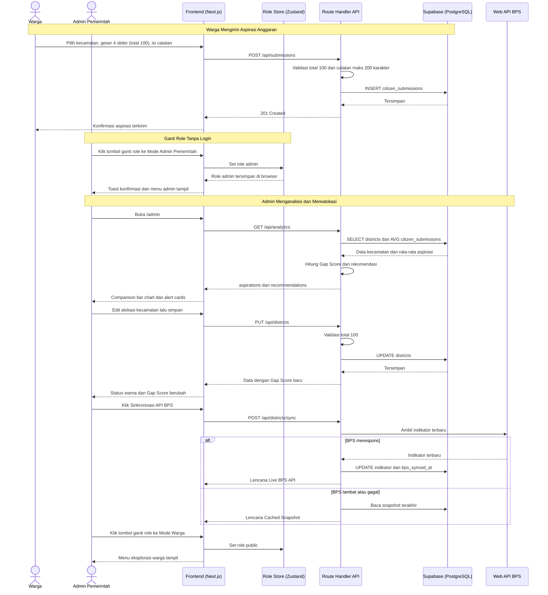
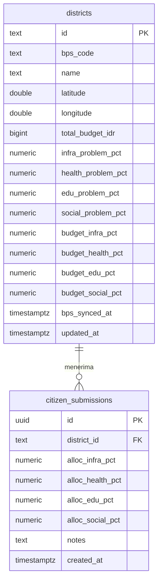

# PRD NalarPublik — Sistem Pendukung Keputusan Transparansi Anggaran Daerah

## 1. **Overview**

NalarPublik adalah platform web *data-driven decision support* yang mempertemukan data anggaran daerah (APBD), data statistik masalah di lapangan (BPS), dan aspirasi warga dalam satu tampilan agar kebijakan anggaran berbasis bukti (*evidence-based policy*). Pengguna utamanya adalah warga Kabupaten Toba dan pejabat/staf pemerintah daerah yang menyiapkan Musrenbang. Model produknya adalah *civic tech* publik dengan satu wilayah percontohan (Kabupaten Toba, Sumatera Utara, kode BPS `1212`, 4 kecamatan: Balige, Laguboti, Porsea, Habinsaran), sehingga bukan *multitenant* dan bukan *marketplace*; produk ini tidak memakai fitur *login* sama sekali dan pengguna berpindah antara Mode Warga dan Mode Admin Pemerintah lewat satu tombol ganti *role* di *Navbar*.

**Masalah yang diselesaikan:** Angka APBD tersaji sebagai dokumen birokratis yang sulit dipahami warga, sementara data masalah dari BPS berada di sumber terpisah sehingga tidak ada yang bisa melihat apakah anggaran sudah mengikuti masalah yang nyata. Akibatnya kesenjangan baru ketahuan setelah dicek manual di *spreadsheet*, dan aspirasi warga di Musrenbang tidak pernah terukur sebagai angka. Contoh konkretnya: Kecamatan Habinsaran punya tingkat jalan rusak 42%, tetapi hanya 15% anggarannya dialokasikan ke infrastruktur (selisih +27 poin).

**Tujuan Utama:** Dari sisi warga, NalarPublik menerjemahkan angka APBD dan BPS menjadi peta, grafik, dan perbandingan antar-kecamatan berbahasa awam, serta menyediakan simulator tempat warga membagi 100% anggaran menurut prioritasnya lewat HP. Dari sisi pemerintah daerah, NalarPublik menyandingkan tingkat masalah, alokasi APBD, dan rata-rata aspirasi warga per sektor, memberi peringatan dan rekomendasi realokasi otomatis sebelum rapat Musrenbang, dan membiarkan admin mengubah alokasi untuk melihat dampaknya pada *Gap Score* secara langsung. Dari sisi penguji, satu tombol ganti *role* cukup untuk mencoba kedua sudut pandang tanpa membuat akun.

## 2. **Requirements**

- **Cakupan Data Percontohan:** Sistem hanya melayani 4 kecamatan di Kabupaten Toba (`balige`, `laguboti`, `porsea`, `habinsaran`) dan 4 sektor tetap (`infra`, `health`, `education`, `social`), tanpa fitur menambah wilayah atau sektor dari UI.
- **Model Data Sederhana (Non-*Multitenant*):** Data disimpan di dua tabel, `districts` untuk master kecamatan, indikator masalah BPS, dan alokasi APBD, serta `citizen_submissions` untuk suara warga, dengan relasi satu kecamatan ke banyak aspirasi.
- **Tombol Ganti *Role* (Tanpa *Login*):** *Navbar* memiliki satu *toggle switch* yang selalu terlihat di desktop dan HP dengan label `Mode: Warga` dan `Mode: Admin Pemerintah`, mengubah variabel `role` (`"public" | "admin"`) di Zustand secara instan tanpa halaman *login*, akun, atau *session*, dengan nilai awal `public`, pilihan disimpan di *browser* (Zustand `persist`) agar tidak kembali ke Mode Warga setelah *refresh*, dan *toast* konfirmasi setiap kali berpindah.
- **Perilaku Tampilan per *Role*:** Mode Warga menampilkan menu eksplorasi (Beranda, Peta, Simulator, Komparasi, Data Terbuka), Mode Admin menampilkan menu Dasbor Keputusan dan Manajemen Data, setiap mode punya lencana warna di *Navbar* yang membedakannya, dan membuka `/admin` saat berada di Mode Warga dialihkan ke Beranda dengan pesan agar beralih ke Mode Admin Pemerintah.
- **Batas Keamanan *Sandbox*:** Karena tidak ada autentikasi, pembatasan *role* hanya di tampilan dan *endpoint* admin (`PUT /api/districts`, `POST /api/districts/sync`) tidak memeriksa siapa pemanggilnya, sehingga produk ini ditetapkan sebagai *sandbox*/demo dan harus ditambah autentikasi sebelum dipakai dengan data resmi.
- **Rumus Gap Terpusat:** *Sector Gap* = persentase masalah sektor dikurangi persentase alokasi anggaran sektor, dan *Overall Gap Score* = rata-rata dari `max(0, gap)` keempat sektor, dihitung oleh satu *helper* `gap-calculator.ts` yang dipakai *frontend* dan *backend* agar hasilnya identik.
- **Klasifikasi Status Wilayah:** Status dihitung saat *request* (tidak disimpan): `CRITICAL` jika ada *Sector Gap* ≥ 20 atau *Overall Gap Score* ≥ 15, `WARNING` jika *Sector Gap* maksimum berada di 10 sampai kurang dari 20, dan `PROPORTIONAL` jika semua *Sector Gap* di bawah 10; saat filter sektor aktif di peta, ambang yang sama dipakai pada *Sector Gap* sektor terpilih.
- **Validasi Total 100%:** Alokasi 4 sektor pada simulator warga dan pada form edit anggaran admin wajib berjumlah tepat 100, dicek di UI (tombol simpan/kirim nonaktif dengan peringatan sisa atau kelebihan poin), di *Route Handler*, dan untuk `citizen_submissions` juga oleh *constraint* `check_total_100` di database.
- **Integrasi BPS *Hybrid* dengan *Fallback*:** Web API BPS (`https://webapi.bps.go.id`, memakai kunci API di variabel lingkungan server) hanya dipanggil dari *Server Route* Next.js, dan bila BPS lambat, gagal, atau tidak punya data tingkat kecamatan, sistem memakai snapshot indikator terakhir di tabel `districts` dan menandai respons sebagai `Cached Snapshot` (bukan `Live BPS API`).
- **Aspirasi *Append-Only* tanpa Akun:** Setiap kiriman warga disimpan sebagai baris baru yang tidak diedit atau dihapus lewat aplikasi, catatan opsional maksimal 200 karakter, satu *browser* dibatasi satu kiriman per kecamatan lewat penanda lokal sebagai pembatasan lunak (bukan jaminan satu orang satu suara), dan agregasi dihitung sebagai `AVG` per sektor per kecamatan beserta `total_votes`.
- ***Mobile-First* dan Bahasa Awam:** Semua halaman publik harus terbaca di layar HP (peta, *slider*, grafik, tabel), dan angka birokrasi diterjemahkan ke ekuivalen yang mudah dipahami seperti kilometer jalan atau unit fasilitas kesehatan.

## 3. **Core Features**

- **Landing Page dan Portal Data Terbuka:** Halaman utama menampilkan *Hero Section* dengan tombol cepat ke Peta dan Simulator, 4 *metric cards* (Total Pagu APBD Kabupaten Toba, rata-rata angka kemiskinan BPS, jumlah kecamatan berstatus `CRITICAL`, total partisipasi suara warga), dan cuplikan ketimpangan antar-kecamatan, sedangkan Portal Data Terbuka menampilkan kartu konversi rupiah ke kilometer jalan atau unit faskes (biaya satuan ditulis sebagai konstanta yang terlihat di kartu agar transparan) dan tombol `Unduh Data Terbuka (CSV)` untuk tabel gabungan APBD dan BPS.
- **Peta Geospasial *Gap Analysis*:** Peta `react-leaflet` berpusat di (2.3500, 99.1500) dengan *zoom* 11 menampilkan 4 *pin marker* berwarna merah (`CRITICAL`), kuning (`WARNING`), atau hijau (`PROPORTIONAL`), filter sektor (`Semua Sektor (Umum)`, `Infrastruktur`, `Kesehatan`, `Pendidikan`, `Sosial`) mengubah warna pin, dan klik pin membuka *drawer* berisi indikator masalah BPS vs alokasi APBD per sektor beserta lencana `Live BPS API` atau `Cached Snapshot`.
- **Simulator Anggaran Partisipatif:** Warga memilih kecamatan domisili, menggeser 4 *slider* sektor hingga tepat 100%, menulis catatan opsional maksimal 200 karakter, lalu menekan `Kirim Aspirasi Anggaran` yang memanggil `POST /api/submissions`, dengan target kurang dari 1 menit dari buka halaman sampai terkirim.
- **Komparasi *Head-to-Head* Antar-Kecamatan:** Dua *dropdown* (Kecamatan A di kiri dan Kecamatan B di kanan) menghasilkan *grouped bar chart* atau *radar chart* `recharts` yang menyandingkan persentase masalah vs persentase alokasi anggaran, plus tabel metrik langsung: Pagu Anggaran (Rp), Jalan Rusak (%), *Stunting* (%), Ruang Kelas Rusak (%), Kemiskinan (%), dan *Gap Score*.
- **Dasbor Keputusan Admin dan Detektor Anomali:** Admin memfilter per kecamatan atau seluruh Kabupaten Toba untuk melihat *comparison bar chart* 3 batang per sektor (tingkat masalah BPS, alokasi APBD saat ini, rata-rata aspirasi warga; batang aspirasi diganti pesan "Belum ada suara" bila belum ada kiriman) dan daftar catatan keluhan terbaru, sementara *alert cards* diurutkan dari *Gap Score* tertinggi dan hanya muncul untuk kecamatan `CRITICAL` atau `WARNING` dengan teks seperti "PERINGATAN KRITIS — Kec. Habinsaran: tingkat kerusakan jalan 42%, alokasi anggaran infrastruktur hanya 15% (*Gap Score*: +27)".
- **Rekomendasi Realokasi dan Manajemen Data Anggaran:** Rekomendasi pada *alert card* menghitung realokasi minimal sebagai *Sector Gap* dikurangi 15 poin (Habinsaran: 27 − 15 = +12%) dan menyarankan sumber dana dari sektor dengan *Sector Gap* paling negatif, lalu admin menerapkannya lewat tabel 4 kecamatan dan *modal form* edit alokasi (`PUT /api/districts`) sehingga *Gap Score* dan warna status langsung berubah, serta tombol `Sinkronisasi API BPS` memicu penarikan ulang indikator BPS.

## 4. **User Flow**

### Warga: Eksplorasi Kesenjangan

1. Membuka landing page NalarPublik dari HP; *role* awal otomatis `Mode: Warga` dan 4 *metric cards* terbaca.
2. Mengklik tombol cepat `Peta Gap Analysis`.
3. Memilih filter sektor (misalnya `Infrastruktur`) dan melihat warna 4 *pin* berubah.
4. Mengklik pin Kecamatan Habinsaran untuk membuka *drawer* dan membaca indikator masalah BPS vs alokasi APBD beserta lencana `Live BPS API` atau `Cached Snapshot`.
5. Membuka halaman Komparasi, memilih Kecamatan A dan Kecamatan B, lalu membaca grafik dan tabel perbandingan.
6. Membuka Portal Data Terbuka, membaca kartu konversi, dan mengklik `Unduh Data Terbuka (CSV)` bila ingin menyimpan datanya.

### Warga: Mengirim Aspirasi Anggaran

1. Mengklik tombol cepat `Simulator Anggaran`.
2. Memilih kecamatan domisili pada *dropdown*.
3. Menggeser 4 *slider* (Infrastruktur, Kesehatan, Pendidikan, Sosial) sampai indikator total menunjukkan tepat 100%; bila kurang atau lebih, membaca peringatan sisa/kelebihan poin dan menyesuaikan.
4. Mengisi catatan lapangan opsional maksimal 200 karakter.
5. Mengklik `Kirim Aspirasi Anggaran`; sistem memvalidasi total 100 dan menyimpan data.
6. Melihat konfirmasi bahwa aspirasi terkirim.

### Admin Pemerintah: Analisis dan Realokasi

1. Mengklik tombol ganti *role* di *Navbar* dari `Mode: Warga` ke `Mode: Admin Pemerintah` (tanpa *login*), lalu melihat *toast* konfirmasi dan menu admin muncul.
2. Membuka halaman `/admin`, memilih filter kecamatan atau agregat seluruh Kabupaten Toba, lalu membaca *comparison bar chart* 3 batang per sektor dan catatan keluhan terbaru warga.
3. Membaca *alert cards* yang diurutkan dari *Gap Score* tertinggi untuk menentukan kecamatan dan sektor prioritas.
4. Pada tabel Manajemen Data, mengklik edit pada Kecamatan Habinsaran, mengubah 4 persentase alokasi (total 100), lalu menyimpan.
5. Melihat *Gap Score* dan status warna kecamatan tersebut berubah langsung setelah penyimpanan.
6. Mengklik `Sinkronisasi API BPS` bila ingin memperbarui indikator masalah dari BPS.
7. Membawa daftar peringatan dan rekomendasi ke rapat Musrenbang (di luar sistem).
8. Mengklik tombol ganti *role* kembali ke `Mode: Warga` bila ingin melihat tampilan publik.

## 5. **Architecture**

Aplikasi dibangun sebagai satu *repo fullstack* dengan **Next.js (App Router, TypeScript)**: halaman UI dan *Route Handler* API berada di proyek yang sama sehingga *frontend* dan *backend* bisa dikerjakan paralel dengan satu kontrak tipe di `src/types/index.ts` dan satu *helper* rumus di `gap-calculator.ts`, serta cukup satu *deployment* ke Vercel pada tahap MVP. Status *role* hidup sepenuhnya di *browser* (Zustand), jadi berpindah mode tidak memanggil server, sedangkan semua akses ke Supabase dan Web API BPS lewat *Route Handler* (`GET /api/districts`, `PUT /api/districts`, `POST /api/districts/sync`, `GET` dan `POST /api/submissions`, `GET /api/analytics`) dengan kunci Supabase hanya di sisi server. Komponen peta `react-leaflet` dijalankan sebagai *Client Component* karena membutuhkan *browser*. Karena hanya ada satu wilayah percontohan dan tanpa akun, tidak ada strategi isolasi data antar-*tenant*; relasi data cukup lewat *foreign key* `citizen_submissions.district_id` ke `districts.id`.

## 6. **Database Schema**

Hierarki data sangat sederhana: satu **Kecamatan (`districts`)** menyimpan indikator masalah BPS dan alokasi anggaran APBD, dan satu kecamatan dapat menerima banyak **Aspirasi Warga (`citizen_submissions`)** (relasi *one-to-many*, `ON DELETE CASCADE`). Tidak ada tabel pengguna atau *session* karena produk tidak memakai *login*, dan tidak ada kolom `status` yang disimpan karena data berupa angka agregat tanpa transaksi per pengguna; status wilayah (`GapStatus`: `CRITICAL`, `WARNING`, `PROPORTIONAL`) dihitung dari kolom persentase memakai rumus di bagian Requirements.

1. **`Kecamatan (districts)` - master wilayah, indikator masalah BPS, dan alokasi APBD**
   - `id` (TEXT): *Primary Key*, *slug* kecamatan (`balige`, `laguboti`, `porsea`, `habinsaran`).
   - `bps_code` (TEXT): kode resmi BPS, misalnya `1212010`.
   - `name` (TEXT): nama kecamatan, misalnya `Kecamatan Balige`.
   - `latitude` (DOUBLE PRECISION): koordinat pusat untuk *pin marker* Leaflet.
   - `longitude` (DOUBLE PRECISION): koordinat pusat untuk *pin marker* Leaflet.
   - `total_budget_idr` (BIGINT): total pagu APBD kecamatan dalam Rupiah.
   - `infra_problem_pct` (NUMERIC(5,2)): persentase jalan rusak (jalan, jembatan, drainase).
   - `health_problem_pct` (NUMERIC(5,2)): persentase *stunting* dan keterbatasan fasilitas kesehatan.
   - `edu_problem_pct` (NUMERIC(5,2)): persentase ruang kelas rusak dan kondisi lama sekolah.
   - `social_problem_pct` (NUMERIC(5,2)): persentase penduduk miskin dan rentan sosial.
   - `budget_infra_pct` (NUMERIC(5,2)): alokasi APBD sektor infrastruktur (total 4 sektor = 100).
   - `budget_health_pct` (NUMERIC(5,2)): alokasi APBD sektor kesehatan.
   - `budget_edu_pct` (NUMERIC(5,2)): alokasi APBD sektor pendidikan.
   - `budget_social_pct` (NUMERIC(5,2)): alokasi APBD sektor sosial.
   - `bps_synced_at` (TIMESTAMPTZ): waktu sinkronisasi BPS berhasil terakhir, boleh kosong.
   - `updated_at` (TIMESTAMPTZ): waktu perubahan terakhir (edit anggaran atau sinkronisasi), default `NOW()`.
   - *Field turunan (dihitung di API, bukan kolom fisik):* `overall_gap_score` (angka) dan `gap_status` (`CRITICAL` | `WARNING` | `PROPORTIONAL`).

2. **`Aspirasi Warga (citizen_submissions)` - hasil simulator anggaran partisipatif per kiriman**
   - `id` (UUID): *Primary Key*, default `gen_random_uuid()`.
   - `district_id` (TEXT): *Foreign Key* ke `districts.id`, `ON DELETE CASCADE`.
   - `alloc_infra_pct` (NUMERIC(5,2)): pilihan warga untuk infrastruktur.
   - `alloc_health_pct` (NUMERIC(5,2)): pilihan warga untuk kesehatan.
   - `alloc_edu_pct` (NUMERIC(5,2)): pilihan warga untuk pendidikan.
   - `alloc_social_pct` (NUMERIC(5,2)): pilihan warga untuk sosial.
   - `notes` (TEXT): catatan/keluhan opsional (maksimal 200 karakter dicek di UI dan API).
   - `created_at` (TIMESTAMPTZ): waktu kiriman, default `NOW()`.
   - *Constraint* `check_total_100`: jumlah keempat kolom `alloc_*_pct` harus tepat 100.

*Data awal (seed):* 4 kecamatan percontohan dengan indikator dan anggaran awal (Habinsaran harus menghasilkan status `CRITICAL` sesuai contoh 42% vs 15%) serta beberapa contoh suara warga, agar dasbor admin tidak kosong saat pertama dibuka.

## 7. **Tech Stack**

- **Framework Fullstack:** **Next.js 14/15 (App Router, TypeScript)** — UI dan *Route Handler* API dalam satu *repo*, cocok untuk MVP karena *frontend* dan *backend* bisa dikerjakan paralel dan langsung di-*deploy* ke Vercel.
- **Styling/UI:** **Tailwind CSS + `shadcn/ui` + `lucide-react`** — komponen siap pakai dan responsif untuk *mobile-first*, sehingga *toggle* ganti *role*, *dashboard*, *modal form*, dan *toast* tidak perlu dibuat dari nol.
- **Database:** **Supabase (PostgreSQL)** — *hosted* sehingga tidak perlu mengelola server, skema dan data awal cukup dijalankan lewat SQL Editor, dan *constraint* `CHECK` menjaga total 100% karena ini tahap MVP.
- **ORM:** **Tanpa ORM, memakai `@supabase/supabase-js` langsung** — hanya ada 2 tabel dan *query* sederhana (*insert*, *update*, `AVG`), jadi ORM belum diperlukan di tahap MVP.
- **Autentikasi:** **Tanpa autentikasi, diganti tombol ganti *role* berbasis Zustand** — sesuai permintaan produk tanpa *login*, penguji berpindah Warga/Admin secara instan; konsekuensinya *endpoint* admin terbuka dan wajib diberi autentikasi sebelum dipakai di luar uji coba.
- **Deployment:** **Vercel** — integrasi bawaan dengan Next.js, *preview* otomatis setiap *commit*, dan variabel lingkungan untuk kunci Supabase serta kunci API BPS cukup diatur lewat `.env.example`.
- **Visualisasi Grafik:** **`recharts`** — menyediakan *bar chart*, *radar chart*, dan *pie/donut chart* untuk komparasi dan dasbor tanpa konfigurasi berat.
- **Peta Geospasial:** **`react-leaflet` + `leaflet`** — gratis tanpa kunci API, cukup dengan *pin marker* di koordinat pusat kecamatan sehingga tidak perlu data batas wilayah (GeoJSON) di tahap MVP.
- **State Management:** **`zustand` (dengan `persist`)** — ringan untuk menyimpan satu status global `role` (`"public" | "admin"`) dan mengingatnya setelah *refresh*.
- **Data Eksternal:** **Web API BPS (`https://webapi.bps.go.id`)** — sumber indikator masalah resmi, dipanggil dari *Server Route* dengan *fallback* ke snapshot database agar aplikasi tetap jalan ketika BPS lambat.
