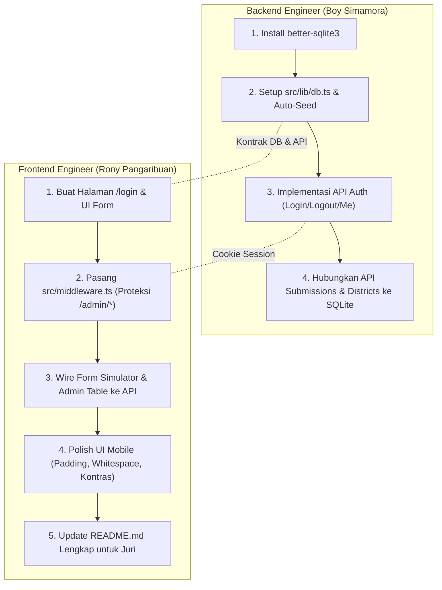

# PRD v2.0 — NalarPublik (Sprint Eksekusi Paralel FE & BE)

> **Kompetisi:** Web In Action (WIA) 2026 — *Designing Digital Futures*
> **Subtema:** *Data-Driven Decision Support*
> **Tim:** Kopi Hitam Pekat 
> **Fokus Sprint:** Transisi dari *In-Memory Mock Data & Sandbox Toggle* menuju **Embedded Persistent SQLite & Real Admin Authentication**, menjawab 100% catatan dewan juri WIA.

---

## 1. Posisi Produk & Peran Pengguna (Role Positioning)

NalarPublik berposisi sebagai **Platform Civic-Tech Pihak Ketiga Independen** (*Independent Civic Transparency Platform*), bukan website internal Bappeda.

* **Mode Warga (Publik — Open Access):**
  * Akses tanpa hambatan login (*frictionless*).
  * Menjelajahi data terbuka APBD Toba yang telah diterjemahkan ramah awam (`/open-data`).
  * Mengeksplorasi peta kesenjangan anggaran BPS (`/map`) dan komparasi kecamatan (`/compare`).
  * Mengirim simulasi aspirasi alokasi 4 sektor (`/simulator`).
* **Mode Admin (Pengelola Platform / Kredensial Khusus):**
  * Membutuhkan **Autentikasi Nyata** (Login Email/Password).
  * Akses penuh ke Dasbor Pengambilan Keputusan (`/admin`) dan Laporan Aspirasi (`/admin/report`).
  * Memiliki wewenang menginput, memutakhirkan pagu APBD hasil kurasi dokumen resmi Pemkab Toba (`PUT /api/districts`).
  * Memantau deteksi anomali selisih anggaran (*Gap Score*) dan aspirasi warga.

---

## 2. Arsitektur Database (Embedded SQLite)

Database berjalan secara lokal dan *embedded* menggunakan file database fisik `nalarpublik.db` di root project.
**Keunggulan untuk Juri:** *Zero setup* (juri cukup `git clone` dan `npm run dev`, database langsung persisten tanpa perlu konfigurasi cloud).

### Skema Tabel (Physical Schema)

```sql
-- 1. Master Kecamatan & Pagu APBD/BPS (Baseline)
CREATE TABLE IF NOT EXISTS districts (
  id TEXT PRIMARY KEY,                       -- 'balige', 'laguboti', 'porsea', 'habinsaran'
  bps_code TEXT NOT NULL,                   -- '1212010'
  name TEXT NOT NULL,                       -- 'Kecamatan Balige'
  latitude REAL NOT NULL,
  longitude REAL NOT NULL,
  population INTEGER NOT NULL,
  total_budget_idr INTEGER NOT NULL,        -- Pagu APBD (Rp)
  infra_problem_pct REAL NOT NULL,          -- BPS: % jalan rusak
  health_problem_pct REAL NOT NULL,         -- BPS: % stunting/faskes minim
  edu_problem_pct REAL NOT NULL,            -- BPS: % kelas rusak/putus sekolah
  social_problem_pct REAL NOT NULL,         -- BPS: % kemiskinan
  budget_infra_pct REAL NOT NULL,           -- Alokasi APBD Infrastruktur (%)
  budget_health_pct REAL NOT NULL,          -- Alokasi APBD Kesehatan (%)
  budget_edu_pct REAL NOT NULL,             -- Alokasi APBD Pendidikan (%)
  budget_social_pct REAL NOT NULL,          -- Alokasi APBD Sosial (%)
  updated_at TEXT DEFAULT CURRENT_TIMESTAMP
);

-- 2. Aspirasi Suara Warga (dari Simulator)
CREATE TABLE IF NOT EXISTS submissions (
  id TEXT PRIMARY KEY,                       -- UUID / 'sub-<timestamp>'
  district_id TEXT NOT NULL REFERENCES districts(id),
  district_name TEXT NOT NULL,
  author TEXT DEFAULT 'Warga Toba',
  alloc_infra_pct INTEGER NOT NULL,
  alloc_health_pct INTEGER NOT NULL,
  alloc_edu_pct INTEGER NOT NULL,
  alloc_social_pct INTEGER NOT NULL,
  notes TEXT,                               -- Maks 200 karakter
  created_at TEXT DEFAULT CURRENT_TIMESTAMP
);

-- 3. Akun Administrator
CREATE TABLE IF NOT EXISTS admins (
  id TEXT PRIMARY KEY,
  email TEXT UNIQUE NOT NULL,
  password TEXT NOT NULL,                   -- Password admin
  name TEXT NOT NULL,
  role TEXT DEFAULT 'admin',
  created_at TEXT DEFAULT CURRENT_TIMESTAMP
);
```

---

## 3. Kontrak API Routes (Request & Response)

### A. Autentikasi (`/api/auth/*`)

#### 1. `POST /api/auth/login`

* **Request Body:**
  ```json
  { "email": "admin@nalarpublik.id", "password": "password123" }
  ```
* **Response Sukses (200 OK):**
  * Set HTTP-Only Cookie: `nalarpublik_session=<token>` (Max-Age: 7 hari).
  * Body: `{ "success": true, "user": { "email": "...", "name": "Admin NalarPublik", "role": "admin" } }`
* **Response Gagal (401 Unauthorized):**
  * Body: `{ "success": false, "error": "Email atau kata sandi tidak valid" }`

#### 2. `POST /api/auth/logout`

* Menghapus cookie `nalarpublik_session`.
* Response: `{ "success": true }`

#### 3. `GET /api/auth/me`

* Memeriksa status login saat ini berdasarkan cookie.

---

### B. Aspirasi Warga (`/api/submissions`)

#### 1. `GET /api/submissions`

* **Query Params:** `?district_id=habinsaran&limit=20` (opsional).
* **Response (200 OK):**
  ```json
  {
    "total": 12,
    "data": [
      {
        "id": "sub-179422",
        "district_id": "habinsaran",
        "district_name": "Kecamatan Habinsaran",
        "author": "Warga Lumban Rau",
        "alloc_infra_pct": 50,
        "alloc_health_pct": 20,
        "alloc_edu_pct": 15,
        "alloc_social_pct": 15,
        "notes": "Jalan rusak parah...",
        "created_at": "2026-11-09T12:00:00Z"
      }
    ]
  }
  ```

#### 2. `POST /api/submissions`

* **Request Body:**
  ```json
  {
    "district_id": "habinsaran",
    "district_name": "Kecamatan Habinsaran",
    "author": "Warga Mandiri",
    "alloc_infra_pct": 40,
    "alloc_health_pct": 25,
    "alloc_edu_pct": 20,
    "alloc_social_pct": 15,
    "notes": "Perlu perbaikan posyandu"
  }
  ```
* **Validasi Server:** Total persentase wajib tepat 100. Notes maksimal 200 karakter.
* **Response (201 Created):** `{ "success": true, "data": { ... } }`

---

### C. Master Anggaran & Gap (`/api/districts`)

#### 1. `GET /api/districts`

* Mengambil data 4 kecamatan dari tabel SQLite `districts`.
* Output dilengkapi kalkulasi *Gap Score* & status (`CRITICAL`, `WARNING`, `BALANCED`).

#### 2. `PUT /api/districts` (Protected — Butuh Sesi Admin)

* **Request Body:**
  ```json
  {
    "id": "habinsaran",
    "budget_infra_pct": 30.0,
    "budget_health_pct": 25.0,
    "budget_edu_pct": 25.0,
    "budget_social_pct": 20.0
  }
  ```
* Update ke tabel `districts`, kembalikan data terkalkulasi baru.

---

## 4. Pembagian Kerja Paralel (Work Breakdown)



### 👤 Tugas Backend Engineer (Boy Simamora)

1. **[B1] Dependency Setup:**
   * `npm install better-sqlite3` dan `npm install -D @types/better-sqlite3`.
2. **[B2] Database Core (`src/lib/db.ts`):**
   * Koneksi singleton SQLite ke `nalarpublik.db`.
   * Skema DDL auto-execute saat startup.
   * Auto-seeding: 4 kecamatan Toba + 9 aspirasi awal + 1 akun admin default (`admin@nalarpublik.id` / `AdminNalar2026!`).
3. **[B3] Auth Endpoints (`src/app/api/auth/`):**
   * `src/app/api/auth/login/route.ts`: Cek password, terbitkan cookie `nalarpublik_session`.
   * `src/app/api/auth/logout/route.ts`: Hapus cookie session.
   * `src/app/api/auth/me/route.ts`: Kembalikan identitas admin yang sedang aktif.
4. **[B4] Database Wiring pada API:**
   * Ganti `memorySubmissions` di `src/app/api/submissions/route.ts` dengan query SQLite `db.prepare(...)`.
   * Ganti `memoryDistricts` di `src/app/api/districts/route.ts` dengan query SQLite `db.prepare(...)`.

---

### 👤 Tugas Frontend Engineer (Rony Pangaribuan)

1. **[F1] Halaman Login Admin (`src/app/login/page.tsx`):**
   * UI form login bersih, modern, dan minimalis.
   * Handler submit menembak `POST /api/auth/login`, jika sukses redirect ke `/admin`.
2. **[F2] Route Gatekeeper (`src/middleware.ts`):**
   * Intercept semua request ke `/admin/:path*`.
   * Periksa keberadaan cookie `nalarpublik_session`.
   * Jika tidak ada cookie, redirect langsung ke `/login?callbackUrl=/admin`.
3. **[F3] UI Navigasi & Role Awareness:**
   * Ganti toggle sandbox lama di Navbar: tambahkan tombol "Masuk Admin" yang mengarah ke `/login`.
   * Jika admin sedang login, tampilkan lencana "Admin Mode" dan tombol "Keluar (Logout)".
4. **[F4] UI Polish & Responsivitas Mobile:**
   * Konsistensi padding & whitespace (terutama layar 375px).
   * Peningkatan kontras teks pada kartu indikator & badge gap (menjawab catatan juri).
5. **[F5] Dokumentasi Final (`README.md`):**
   * Cantumkan deskripsi proyek, arsitektur SQLite, panduan running (`npm run dev`), dan progress capaian fitur untuk juri WIA.

---

## 5. Kriteria Keberhasilan (Definition of Done)

1. [X] **Tidak ada lagi data mock in-memory:** Aspirasi baru dari simulator tetap ada saat server di-*restart*.
2. [X] **Autentikasi riil aktif:** Route `/admin` tidak bisa dibuka secara langsung via URL tanpa login admin.
3. [X] **Zero configuration:** Siapapun (termasuk dewan juri) yang meng-clone repo cukup menjalankan `npm install && npm run dev` dan sistem langsung berjalan 100%.
4. [X] **TypeScript lolos tanpa error:** `npm run typecheck` (`tsc --noEmit`) menghasilkan exit code 0.
